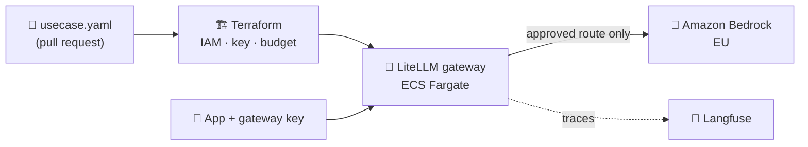
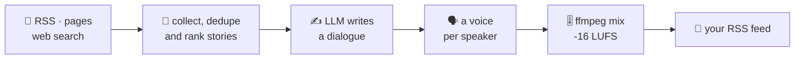

<p align="center">
  
</p>

<p align="center">
  <a href="https://faaizzz.github.io"></a>
  <a href="https://www.linkedin.com/in/faaiz-rissad/"></a>
</p>

### `$ kubectl describe engineer faaiz`

Eleven years in, I spend my days on the plumbing that makes LLMs safe to hand to a whole company: gateways that decide who may call which model, what it costs, and what gets logged. If I were one of my own gateway's use cases, my onboarding file would look like this:

```yaml
# usecases/faaiz.yaml
metadata:
  id: faaiz-k-rissad
  role: GenAI Platform Engineer
  location: Mülheim an der Ruhr, Germany 🇩🇪
spec:
  modelRoutes: [azure-ai-foundry, azure-openai, amazon-bedrock, litellm]
  runtime: [aks, ecs-fargate, docker]
  provisioning: terraform        # never click-ops
  delivery: gitops               # argocd, merge to deploy
  observability:
    tier: everything             # langfuse traces, cost per call
  certifications: [azure-ai-engineer-associate]
  budget:
    coffee: unlimited            # ASSUMPTION, not an approved budget
```

---

## 🛡️ [AWS AI Gateway with LiteLLM](https://github.com/faaizzz/aws-ai-gateway-with-litellm-poc)

> A product team onboards an AI use case by editing **one YAML file** and opening a pull request.

Terraform turns that file into least-privilege IAM, an approved model route, a route-scoped gateway key and a budget. Bad requests never reach a model: a wrong route or data classification fails at `terraform plan`, and at runtime a model override, a bad key or an empty budget is refused.



`Terraform` `LiteLLM` `Amazon Bedrock` `ECS Fargate` `Langfuse` `GitHub Actions` · 31 Terraform test runs, tflint and trivy on every PR

## 🎙️ [BYOP — Bring Your Own Podcast](https://github.com/faaizzz/Bring-Your-Own-Podcast-BYOP)

> **Your sources in, a podcast out.**

A self-hosted app that reads the feeds, pages and searches you care about and turns them into a scheduled, multi-speaker AI podcast with its own RSS feed, playable in Apple Podcasts or Spotify. Bring any LLM and voice provider, or run it all locally for free.



`Python` `FastAPI` `Celery` `PostgreSQL` `React` `TypeScript` `Docker` · cost tracking per call, Langfuse tracing, Playwright end-to-end tests

---

## 🧰 Toolbox

<p align="center">
  
</p>

<p align="center"><sub>Also: Azure AI Foundry · Azure API Management · ArgoCD · LangChain / LangGraph · LiteLLM · Langfuse</sub></p>

## 🐍 Contributions, eaten daily

<picture>
  <source media="(prefers-color-scheme: dark)" srcset="https://raw.githubusercontent.com/faaizzz/faaizzz/output/github-snake-dark.svg"/>
  <source media="(prefers-color-scheme: light)" srcset="https://raw.githubusercontent.com/faaizzz/faaizzz/output/github-snake.svg"/>
  
</picture>


